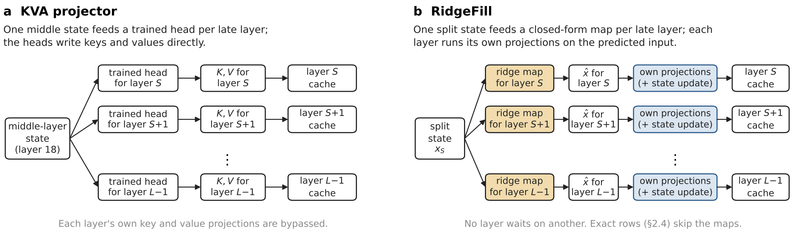

<p align="center"></p>

<p align="center"><b>Faster long-prompt prefill: late-layer caches filled from closed-form ridge maps.</b></p>
<p align="center"><b>No training and no dropped tokens. 1.25 to 1.31× faster time to first token on Qwen3.8-27B in llama.cpp.</b></p>

<p align="center">
<a href="#what-is-ridgefill">What is RidgeFill</a> ·
<a href="#results">Results</a> ·
<a href="#reproducing-results">Reproducing results</a> ·
<a href="#maps">Maps</a> ·
<a href="https://github.com/Approximate-Science/llama.cpp-ridgefill">llama.cpp fork</a> ·
<a href="#citation">Citation</a>
</p>

## What is RidgeFill

RidgeFill shortens prefill by not computing most of a model's upper layers for the prompt. The lower layers run
exactly up to a split. From the split layer's state, one ridge map per later layer predicts that layer's input, and
the layer writes its cache from the prediction instead of running in full. The maps are fitted once, in closed form,
from one pass over calibration text. A chosen set of rows, the last few thousand prompt tokens and every decoding step
run the full model, so nothing is trained and no token is dropped.

This repository holds the data and code of the paper *RidgeFill: Training-Free Late-Layer Cache Fill for Faster
Prefill* by Dylan Johnston and tcclaviger, which is in preparation. Every number in the paper can be recomputed from
the files here, without any benchmark or calibration text. Code is released under Apache-2.0 (`LICENSE`) and results
under CC BY 4.0 (`LICENSE-DATA`); [Licences](#licences) gives the licence of every path.

## How it works

<p align="center"></p>

The design comes from DeepSeek-V4.1-Flash, where the projection is trained into the model. kishida's Q3-8B-KVA-Projector,
posted the day that model came out, retrofitted it onto Qwen3-8B with trained heads that write keys and values
directly (a). RidgeFill (b)
instead predicts each late layer's input with a ridge map, so the layer's own projections run unchanged, and on a
Gated DeltaNet layer so does its state update. Exact rows skip the map and run the layer from its exact input.

## Results

| Model and engine | Speed | Quality |
|---|---|---|
| Qwen3.8-27B, llama.cpp fork, one A100 | 1.25 to 1.31× faster time to first token at 16K to 120K tokens | RULER −1.2 and −1.4 points at 16K and 32K, LongBench v2 −1.4 points; each 95 % interval includes zero |
| Qwen3.8-Flash-Next, vLLM fork, two R9700 | 1.50 to 1.60× faster time to first token at 9K to 32K tokens | RULER needle tasks 99.8 against 100.0; perplexity on novel tokens +2.65 % [−0.02 %, +4.93 %] |

On three 8 to 9B reference models (Llama-3.1-8B, Qwen3.5-9B, Qwen3-8B), at the same split and tail as the identity
fill, the fitted map retrieves 39.7 and 49.6 more filled-region RULER points on the two dense models, and it is level
with the released SwiftKV checkpoint on long-document loss.

## Reproducing results

```bash
sha256sum -c MANIFEST.sha256 --quiet               # every file, against the manifest
bash recompute/run_all.sh > recompute.out          # prints id<TAB>value for every recomputed number
python3 recompute/gate.py recompute.out            # compares them with derived/claims.csv; exit 0 = all match
python3 tools/verify_ledger.py provenance/ledger   # the ledger's hash chain
python3 tools/selftest.py                          # controls for the strip, scan and ledger tools
```

The recompute scripts need Python 3.10 or later with numpy, nothing else; `run_all.sh` uses `python3` unless the
`PYTHON` variable names another interpreter (for example a virtual environment with numpy). `recompute/fig_speedup_gap.py`
also needs matplotlib. `CLAIMS.md` maps each claim of the paper to its files, its script and its number of checked
values; `REPRODUCE.md` is a checklist for redoing the load-bearing numbers by hand.

## What is here

| Part | Paper | Path |
|---|---|---|
| Qwen3.8-27B in llama.cpp on four A100s: TTFT, RULER, LongBench v2, post-prompt KL, gates, BF16 reference, multi-user runs | §4 | `results/qwen38-27b/` (LongBench v2 per item in `results/qwen38-27b/longbench/`) |
| Qwen3.8-Flash-Next in vLLM on two R9700s: TTFT, 64K request time, perplexity, RULER, determinism | §5 | `results/flashnext/final-det-20261010/` |
| Reference study on Llama-3.1-8B, Qwen3.5-9B and Qwen3-8B: every arm of every cell, per sample | §6, Appendices A–E | `results/reference/` (19 cells) |
| Development measurements behind §1, §3 and Appendix I, status DEVELOPMENT (not evidence for §4 to §6) | Appendix I | `results/development/` |
| Per-document loss table of the reference study; key (model, set, doc), since 25 of the 30 fresh document names repeat locked-set names | §9, Appendix A | `derived/per-document-nll.csv` |
| Reference implementation, fit and finals pipeline, tests | §2, §9 | `code/` (kva, scripts, finals, configs, tests) |
| Flash-Next run kit (commit d1164746) and the determinism fix (diff and hashes) | §5, Appendix F | `code/c5/`, `code/engine-fix/` |
| 27B measurement kit and LongBench v2 runner | §4 | `code/qwen38-27b-kit/` |
| Lean statements | Appendix H | `code/lean/kva_lean/` |
| Code of each run commit, as diffs against the export | Appendix F | `code/run-commit-diffs/`, `code/RUN-COMMITS.md` |
| Recompute scripts, one per derived number | all | `recompute/` |
| Fit records (rows, documents, λ, map hashes) | §2.2, Appendix G | `provenance/fits/` |
| Input manifests: hashes and pointers, no texts; per-document hashes of the calibration documents | §3, Appendix G | `provenance/inputs/` |
| Calibration overlap checks | Appendix G | `provenance/checks/` |
| Run ledger, a hash-chained log: chain index and the cited entries | §9 | `provenance/ledger/` |
| Models, maps, engine image, forks, benchmarks and excluded large files, by revision and sha256 | Appendix F | `provenance/external.tsv` |
| The paper's 15 figures as printed; Figure 10 is redrawn from the timing records by `recompute/fig_speedup_gap.py` (needs matplotlib) | all | `figures/` |
| Claim → file → script map | all | `CLAIMS.md`, `derived/claims.csv` |

Outside this repository:

- **llama.cpp fork:** https://github.com/Approximate-Science/llama.cpp-ridgefill. The 27B runs used runtime commit
  `b0439f7bb52b2551c80c9f6b2f9dfc4c1a6519d7` and scorer commit `b70b0c5b4847d51f02421ce5895e873d8930efe2`,
  against upstream ggml-org/llama.cpp `1242be66f65d5d8a3d996ba56d6de106ced98cf6`.
- **Flash-Next engine:** the public image `tcclaviger/vllm:29.08.10`, digest
  `sha256:809657ddb1533db10a0c08267c3ee6fde180b839e379713414efa121415914a3` (vLLM 0.29.0.dev0 at upstream
  `2bdbbc80804b2199cbf39b75e78cf7269d0383a4` plus the fork's patches; the fork's source is not public). The
  determinism fix replaces one file; `code/engine-fix/` has the diff and both files' hashes.
- **Maps** (Hugging Face, organization TheCacheIsALie): see [Maps](#maps).
- **Technical note** that preceded the paper: DOI 10.5281/zenodo.23179168. `SUPERSEDED.md` says which of its numbers
  the paper replaces.

## Maps

Every map file a run loaded is listed in `provenance/external.tsv` with its repository, path, bytes and sha256, and
each cell's `cell.json` names the sha256 of the maps it loaded. Identify a map by its sha256; file names alone are
not enough (`SUPERSEDED.md`).

Public (organization TheCacheIsALie on Hugging Face):

| Repository | Revision | Files |
|---|---|---|
| `RidgeFill-Projector-Qwen3.8-27B-i8` | `d24ace6c3b176681b7075568134b150118a8b566` | the split-16 maps as one GGUF (Q8_0) file, the file the 27B runs loaded (unchanged since `07eb31cd`), and in `ridgefill-projector-qwen3.8-27b-i8/` the int8 release it was converted from |
| `RidgeFill-Projector-Qwen3.8-Flash-Next-i8` | `0b6f2ce017fe912198c697bcc813a1578bc67ce1` | the split-24 int8 maps, correction and row table the Flash-Next runs loaded; since `2c50360e` also `source/kva-big-s24.safetensors`, the bf16 fit those maps were quantized from, whose `final` map `code/c5/convert.py` copies into the engine's files |
| `Llama-3.1-8B-Instruct-RidgeFill-Projector` | `6649dc3621ab11e9c2c5553343147bffe6800a85` | the bf16 safetensors maps the reference cells loaded, splits 8, 12, 16 and 20, in `safetensors/`; split 12 converted to GGUF (bf16, Q8_0) for the llama.cpp fork |
| `RidgeFill-Projector-Qwen3-8B` | `fb663bb44f20c46fbb63bf6ba6a0d6e5dcc3f711` | the bf16 safetensors maps the reference cells loaded, splits 9, 13, 18 and 22, in `safetensors/`; split 13 converted to GGUF (bf16, Q8_0) for the llama.cpp fork |
| `RidgeFill-Projector-Qwen3.5-9B` | `59d77e33cef73c6e387973f9e6926bd956867873` | the bf16 safetensors maps the reference cells loaded, splits 8, 12, 16 and 20 |

Every file in these repositories that a run loaded has its sha256 and bytes in `provenance/external.tsv`, so the
reference study can be rerun with the paper's maps.

## Names used in the files

The code calls the method KVA, after the projector design it retrofits. In the per-document loss records
(`samples/longppl/`), the arms are `exact`, `kva` (RidgeFill), `noproj` (the identity fill, POP's fill at the same
split and tail), `skip` (no fill), and suffixed variants such as `kva+ktail`. In the RULER, decode and second-question
records the same arms are named `exact`, `ridgefill`, `identity`, `nofill`, `pop-native` (POP at its own split, one-token
tail), and `+rows` (attention-selected exact rows), `+random`, `+qblind`, `+tailmatch`, `+kexact`, `+vexact`, with the
split appended (`-s12`). Depth keys are `1/4`, `3/8`, `1/2`, `5/8` (fraction of the layers below the split), `pop` (POP's
split) and `-` (exact). Each cell's `cell.json` lists its arms, splits, model revision and the sha256 of every map it
loaded.

## What was transformed, and what is left out

Nothing in `results/` was edited by hand. A few fields were replaced, by `tools/strip_prompts.py`, and each
transformed file has a row in `provenance/STRIPPED.tsv` with its original sha256 (withheld only where noted):

- **Prompts.** Every `prompt` and `messages` field in the 27B records (RULER haystacks, LongBench v2 contexts,
  UltraChat timing prompts) is replaced by `{"stripped": true, "sha256": <sha256 of the field's canonical JSON>, "n":
  <length>}`. Canonical JSON is `json.dumps(value, sort_keys=True, separators=(",", ":"), ensure_ascii=False)` in UTF-8,
  so a reader who rebuilds a prompt from `provenance/inputs/` can check it against the record.
- **Gold answers of third-party benchmarks are removed, not hashed.** The `refs` field of the Llama LongBench v1
  cell, the `gold` field of every LongBench v2 record and the `refs` of the Qwen3-8B RULER `qa_1` records (SQuAD
  answers) are replaced by `{"stripped": true, "n": <length>}`. Many of these values are short (one of four letters,
  a class label from the list in the same record, yes or no), so a hash would give them away; for the same reason
  `STRIPPED.tsv` lists those files' original hashes as `withheld`, and the runner's per-record `.sha256` files of
  those records are left out. The records keep each item's score (`judge`, per-arm scores), so every number
  recomputes without the answers. Where a model answered correctly, its stored prediction still shows the answer it
  gave; the benchmarks themselves are public. One Llama LongBench output that reproduced a third-party author's
  e-mail address from a code header has that address replaced by `EMAIL-1`.
- **Hardware and machine identifiers.** The authors' own machine's GPU UUID, PCI id, hostname and home-directory
  paths (in the Qwen3-8B fit records; the paths also in the Flash-Next run's boot records, driver logs and fit logs), the PCI
  ids in all fit records, and the rented A100s'
  GPU UUIDs (27B run) are replaced by labels such as `GPU_UUID-1` or `WORKSTATION_PATH-2`. A label is consistent
  within one transformed tree (equal values get equal labels), not across trees. The PCI bus addresses of the rented
  cloud GPUs (reference cells, 27B run) and the container hostnames (random container ids) of the rented machines
  (reference cells, fit records) are kept.
- **Server logs.** The 27B run's `*.log` files are stored gzip-compressed (`*.log.gz`).

Left out: benchmark, calibration and evaluation texts (hashes and pointers only; the calibration documents are
identified only by per-document sha256, `provenance/inputs/calibration-docs.tsv`); the 27B logit dumps used by the
byte-identity gate (998 MiB, sha256 in `provenance/external.tsv`); nvidia-smi dumps; operator files of the rented
machines; abandoned and superseded runs (`results/reference/ABANDONED.md`, `SUPERSEDED.md`).

## Rerunning instead of recomputing

Recomputing needs only this repository. Rerunning the models needs:

- the models at the revisions in `provenance/external.tsv` and each `cell.json`;
- the engines above (the 27B kit builds the fork and upstream from source archives whose hashes are in
  `provenance/inputs/qwen38-27b/LOCK.json`);
- the prompts, rebuilt from the pointers in `provenance/inputs/` and checked against the stripped hashes;
- comparable hardware: the 27B on A100 40 GB cards, Flash-Next on two AMD Radeon AI PRO R9700, the reference cells
  on rented RTX 4090, L40S, RTX 6000 Ada and A100 cards (each cell's `host.json`).

## Licences

| Path | Licence |
|---|---|
| `code/`, `recompute/`, `tools/` | Apache-2.0 (`LICENSE`) |
| `code/qwen38-27b-kit/vendor/` | upstream: LongBench pieces MIT, RULER metrics Apache-2.0 (`NOTICE`) |
| `code/engine-fix/patch-qsa-v3.diff` | Apache-2.0 (a diff against an Apache-2.0 vLLM file) |
| `results/`, `derived/`, `provenance/`, `figures/`, documentation | CC BY 4.0 (`LICENSE-DATA`) |

Model outputs in `results/` remain subject to the licences of the models that produced them (`NOTICE`); the Llama 3.1
outputs are Built with Llama.

## Citation

The paper is in preparation. Until it is out, cite this data release (`CITATION.cff`):

```bibtex
@misc{johnston2026ridgefilldata,
  author  = {Johnston, Dylan and {tcclaviger}},
  title   = {{RidgeFill}: data and code for ``Training-Free Late-Layer Cache Fill for Faster Prefill''},
  year    = {2026},
  version = {1.2},
  url     = {https://github.com/Approximate-Science/ridgefill-data}
}
```

An earlier technical note is archived at [doi:10.5281/zenodo.23179168](https://doi.org/10.5281/zenodo.23179168). The
paper replaces some of its numbers; `SUPERSEDED.md` lists which.

Problems with a file or a number: open an issue on this repository.
